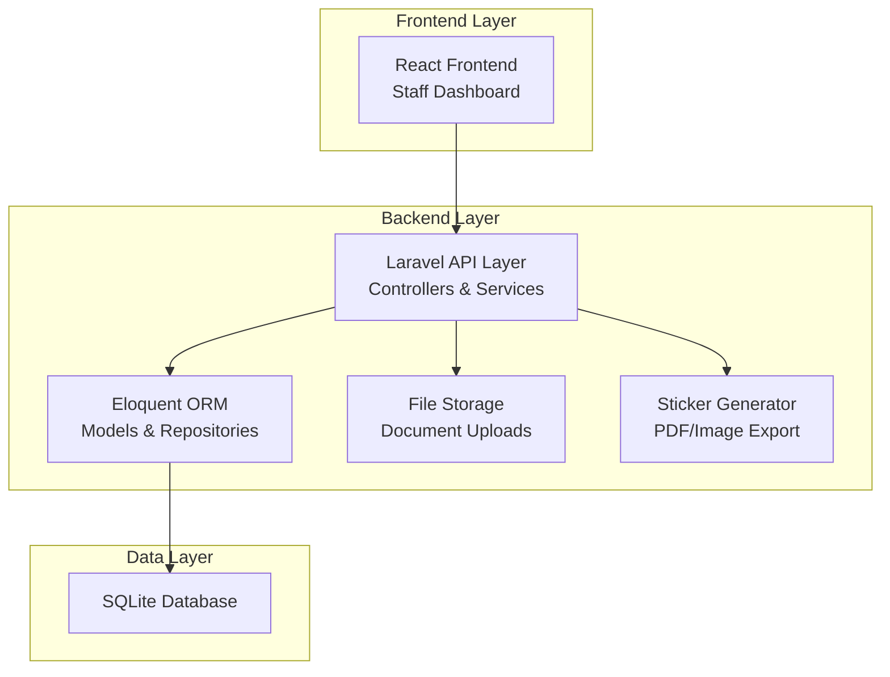
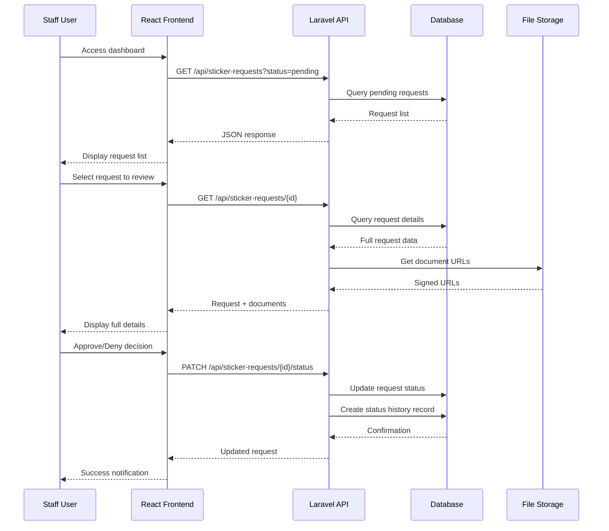
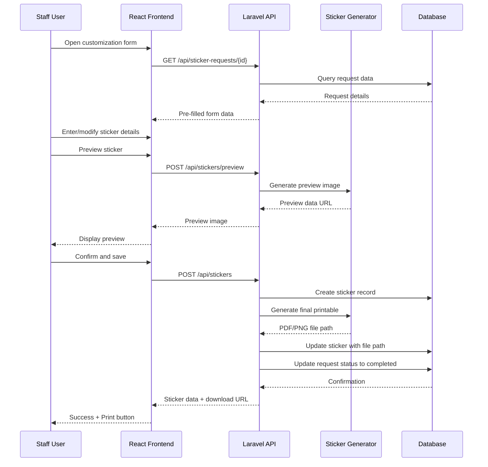

# Design Document: Staff-Side Sticker Request Management System

## Overview

The Staff-Side Sticker Request Management System is a web application that enables Mindoro State University staff to manage student gate pass sticker requests. The system provides a comprehensive workflow for receiving, reviewing, approving/denying, customizing, and generating print-ready gate pass stickers for students. 

The application consists of a Laravel 13 backend providing RESTful APIs and a React 19 frontend delivering an intuitive user interface. Staff members can view incoming requests, review uploaded documents, make approval decisions, customize approved stickers with vehicle and student information, and generate print-ready outputs based on the university's official sticker template.

The system handles the complete lifecycle of sticker requests: from initial submission by students (handled by a separate student-facing application) through staff review and approval, to final sticker customization and print preparation. The design emphasizes efficient request processing, secure document handling, and flexible sticker customization while maintaining data integrity and audit trails.

## Architecture

The system follows a client-server architecture with clear separation between the presentation layer (React SPA), application layer (Laravel API), and data layer (SQLite database). The architecture supports RESTful communication, file storage management, and stateless authentication.



## Sequence Diagrams

### Request Review and Approval Flow



### Sticker Customization and Print Flow



## Components and Interfaces

### Backend Components

#### 1. StickerRequestController

**Purpose**: Handles HTTP requests related to sticker requests, including listing, viewing, and status updates.

**Interface**:
```php
namespace App\Http\Controllers\Api;

use App\Http\Controllers\Controller;
use App\Http\Requests\UpdateStickerRequestStatusRequest;
use App\Services\StickerRequestService;
use Illuminate\Http\JsonResponse;
use Illuminate\Http\Request;

class StickerRequestController extends Controller
{
    public function __construct(
        private StickerRequestService $service
    ) {}
    
    public function index(Request $request): JsonResponse;
    
    public function show(string $id): JsonResponse;
    
    public function updateStatus(
        string $id, 
        UpdateStickerRequestStatusRequest $request
    ): JsonResponse;
}
```

**Responsibilities**:
- Validate incoming HTTP requests
- Delegate business logic to service layer
- Transform service responses into JSON
- Handle HTTP status codes and error responses

#### 2. StickerController

**Purpose**: Manages sticker creation, customization, preview generation, and print-ready file generation.

**Interface**:
```php
namespace App\Http\Controllers\Api;

use App\Http\Controllers\Controller;
use App\Http\Requests\CreateStickerRequest;
use App\Http\Requests\PreviewStickerRequest;
use App\Services\StickerService;
use Illuminate\Http\JsonResponse;
use Symfony\Component\HttpFoundation\BinaryFileResponse;

class StickerController extends Controller
{
    public function __construct(
        private StickerService $service
    ) {}
    
    public function preview(PreviewStickerRequest $request): JsonResponse;
    
    public function store(CreateStickerRequest $request): JsonResponse;
    
    public function show(string $id): JsonResponse;
    
    public function download(string $id): BinaryFileResponse;
}
```

**Responsibilities**:
- Validate sticker customization data
- Coordinate preview and final sticker generation
- Serve downloadable sticker files
- Link stickers to their parent requests

#### 3. StickerRequestService

**Purpose**: Encapsulates business logic for managing sticker requests, status transitions, and validation rules.

**Interface**:
```php
namespace App\Services;

use App\Models\StickerRequest;
use App\Enums\RequestStatus;
use Illuminate\Contracts\Pagination\LengthAwarePaginator;
use Illuminate\Support\Collection;

class StickerRequestService
{
    public function getRequests(
        ?RequestStatus $status = null,
        int $perPage = 15
    ): LengthAwarePaginator;
    
    public function getRequestById(string $id): StickerRequest;
    
    public function updateStatus(
        string $id,
        RequestStatus $newStatus,
        ?string $remarks = null,
        ?int $staffId = null
    ): StickerRequest;
    
    public function validateStatusTransition(
        RequestStatus $currentStatus,
        RequestStatus $newStatus
    ): bool;
    
    public function getRequestDocuments(string $requestId): Collection;
}
```

**Responsibilities**:
- Implement business rules for request management
- Enforce status transition validation
- Manage request-document relationships
- Create audit trail for status changes

#### 4. StickerService

**Purpose**: Handles sticker generation, customization logic, template rendering, and file output creation.

**Interface**:
```php
namespace App\Services;

use App\Models\Sticker;
use App\Models\StickerRequest;
use App\DTOs\StickerCustomizationData;

class StickerService
{
    public function __construct(
        private StickerGeneratorService $generator
    ) {}
    
    public function generatePreview(
        StickerCustomizationData $data
    ): string; // Returns base64 encoded image
    
    public function createSticker(
        string $requestId,
        StickerCustomizationData $data
    ): Sticker;
    
    public function getStickerById(string $id): Sticker;
    
    public function regenerateSticker(string $id): Sticker;
    
    public function getStickerFilePath(string $id): string;
}
```

**Responsibilities**:
- Orchestrate sticker creation workflow
- Coordinate with generator for rendering
- Persist sticker data to database
- Manage sticker file storage

#### 5. StickerGeneratorService

**Purpose**: Low-level service for rendering sticker templates into print-ready formats (PDF/PNG).

**Interface**:
```php
namespace App\Services;

use App\DTOs\StickerCustomizationData;

class StickerGeneratorService
{
    public function renderPreview(
        StickerCustomizationData $data
    ): string; // Base64 image
    
    public function renderPrintable(
        StickerCustomizationData $data,
        string $format = 'pdf'
    ): string; // File path
    
    public function getNextSerialNumber(): string;
    
    private function loadTemplate(): string;
    
    private function replaceTemplatePlaceholders(
        string $template,
        StickerCustomizationData $data
    ): string;
}
```

**Responsibilities**:
- Load and parse sticker template
- Replace placeholders with actual data
- Generate serial numbers
- Export to PDF/PNG formats
- Ensure print quality and dimensions

### Frontend Components

#### 1. RequestListPage

**Purpose**: Main dashboard page displaying all sticker requests with filtering and search capabilities.

**Interface**:
```typescript
interface RequestListPageProps {
  initialFilters?: RequestFilters;
}

interface RequestFilters {
  status?: RequestStatus;
  search?: string;
  dateFrom?: string;
  dateTo?: string;
}

export const RequestListPage: React.FC<RequestListPageProps> = (props) => {
  // Component implementation
};
```

**Responsibilities**:
- Display paginated list of requests
- Provide filtering UI (status, date range, search)
- Handle navigation to detail view
- Show request summary cards

#### 2. RequestDetailPage

**Purpose**: Detailed view of a single sticker request with document viewer and approval controls.

**Interface**:
```typescript
interface RequestDetailPageProps {
  requestId: string;
}

export const RequestDetailPage: React.FC<RequestDetailPageProps> = (props) => {
  // Component implementation
};
```

**Responsibilities**:
- Display comprehensive request information
- Show student details and vehicle information
- Render uploaded documents (images/PDFs)
- Provide approve/deny action buttons
- Display status history timeline

#### 3. DocumentViewer

**Purpose**: Component for viewing uploaded student documents (ID, registration, etc.).

**Interface**:
```typescript
interface DocumentViewerProps {
  documents: Document[];
  onDocumentSelect?: (doc: Document) => void;
}

interface Document {
  id: string;
  type: string;
  name: string;
  url: string;
  uploadedAt: string;
}

export const DocumentViewer: React.FC<DocumentViewerProps> = (props) => {
  // Component implementation
};
```

**Responsibilities**:
- Display document thumbnails
- Open documents in lightbox/modal
- Support zoom and download
- Handle different file types (images, PDFs)

#### 4. StickerCustomizationForm

**Purpose**: Form for customizing sticker details before final generation.

**Interface**:
```typescript
interface StickerCustomizationFormProps {
  requestId: string;
  initialData?: Partial<StickerCustomization>;
  onSubmit: (data: StickerCustomization) => Promise<void>;
  onPreview: (data: StickerCustomization) => Promise<string>;
}

interface StickerCustomization {
  plateNumber: string;
  studentName: string;
  studentId: string;
  vehicleType: VehicleType;
  price: number;
  serialNumber?: string;
  remarks?: string;
}

export const StickerCustomizationForm: React.FC<StickerCustomizationFormProps> = (props) => {
  // Component implementation
};
```

**Responsibilities**:
- Render input fields for sticker data
- Validate input according to rules
- Show live preview of sticker
- Handle form submission
- Display error messages

#### 5. StickerPreview

**Purpose**: Visual preview component showing how the final sticker will appear.

**Interface**:
```typescript
interface StickerPreviewProps {
  data: StickerCustomization;
  loading?: boolean;
  onRefresh?: () => void;
}

export const StickerPreview: React.FC<StickerPreviewProps> = (props) => {
  // Component implementation
};
```

**Responsibilities**:
- Display sticker template with data
- Match print dimensions and layout
- Show real-time updates as form changes
- Provide refresh capability

#### 6. ApprovalDialog

**Purpose**: Modal dialog for approving or denying requests with remarks.

**Interface**:
```typescript
interface ApprovalDialogProps {
  open: boolean;
  requestId: string;
  action: 'approve' | 'deny';
  onClose: () => void;
  onConfirm: (remarks?: string) => Promise<void>;
}

export const ApprovalDialog: React.FC<ApprovalDialogProps> = (props) => {
  // Component implementation
};
```

**Responsibilities**:
- Confirm approval/denial action
- Collect optional remarks
- Handle submission
- Show loading and error states

## Data Models

### Backend Models (Laravel/Eloquent)

#### StickerRequest Model

```php
namespace App\Models;

use Illuminate\Database\Eloquent\Model;
use Illuminate\Database\Eloquent\Relations\BelongsTo;
use Illuminate\Database\Eloquent\Relations\HasMany;
use Illuminate\Database\Eloquent\Relations\HasOne;
use App\Enums\RequestStatus;
use App\Enums\VehicleType;

class StickerRequest extends Model
{
    protected $fillable = [
        'student_id',
        'status',
        'vehicle_type',
        'vehicle_plate_number',
        'remarks',
        'reviewed_by',
        'reviewed_at',
    ];
    
    protected $casts = [
        'status' => RequestStatus::class,
        'vehicle_type' => VehicleType::class,
        'reviewed_at' => 'datetime',
    ];
    
    public function student(): BelongsTo;
    
    public function documents(): HasMany;
    
    public function sticker(): HasOne;
    
    public function statusHistory(): HasMany;
    
    public function reviewedBy(): BelongsTo;
}
```

**Validation Rules**:
- `student_id`: required, exists in users table
- `status`: required, one of: pending, approved, denied, completed
- `vehicle_type`: required, one of: motorcycle, car, suv, van
- `vehicle_plate_number`: required, string, max 20 characters, unique per active request
- `remarks`: nullable, string, max 500 characters

#### Sticker Model

```php
namespace App\Models;

use Illuminate\Database\Eloquent\Model;
use Illuminate\Database\Eloquent\Relations\BelongsTo;
use App\Enums\VehicleType;

class Sticker extends Model
{
    protected $fillable = [
        'sticker_request_id',
        'serial_number',
        'plate_number',
        'student_name',
        'student_id_number',
        'vehicle_type',
        'price',
        'file_path',
        'file_format',
        'generated_by',
        'generated_at',
    ];
    
    protected $casts = [
        'vehicle_type' => VehicleType::class,
        'price' => 'decimal:2',
        'generated_at' => 'datetime',
    ];
    
    public function request(): BelongsTo;
    
    public function generatedBy(): BelongsTo;
}
```

**Validation Rules**:
- `sticker_request_id`: required, exists in sticker_requests table
- `serial_number`: required, string, unique, format: MSU-YYYY-XXXXX
- `plate_number`: required, string, max 20 characters
- `student_name`: required, string, max 255 characters
- `student_id_number`: required, string, max 50 characters
- `vehicle_type`: required, enum value
- `price`: required, numeric, min 0
- `file_path`: required, string, valid file path
- `file_format`: required, one of: pdf, png

#### RequestDocument Model

```php
namespace App\Models;

use Illuminate\Database\Eloquent\Model;
use Illuminate\Database\Eloquent\Relations\BelongsTo;

class RequestDocument extends Model
{
    protected $fillable = [
        'sticker_request_id',
        'document_type',
        'file_name',
        'file_path',
        'file_size',
        'mime_type',
    ];
    
    protected $casts = [
        'file_size' => 'integer',
    ];
    
    public function request(): BelongsTo;
}
```

**Validation Rules**:
- `document_type`: required, one of: student_id, registration, photo, other
- `file_name`: required, string
- `file_path`: required, string, valid file path
- `file_size`: required, integer, max 10485760 (10MB)
- `mime_type`: required, one of: image/jpeg, image/png, image/jpg, application/pdf

#### RequestStatusHistory Model

```php
namespace App\Models;

use Illuminate\Database\Eloquent\Model;
use Illuminate\Database\Eloquent\Relations\BelongsTo;
use App\Enums\RequestStatus;

class RequestStatusHistory extends Model
{
    protected $table = 'request_status_histories';
    
    protected $fillable = [
        'sticker_request_id',
        'from_status',
        'to_status',
        'remarks',
        'changed_by',
    ];
    
    protected $casts = [
        'from_status' => RequestStatus::class,
        'to_status' => RequestStatus::class,
    ];
    
    public function request(): BelongsTo;
    
    public function changedBy(): BelongsTo;
}
```

### Frontend Types (TypeScript)

#### Core Type Definitions

```typescript
// Enums
export enum RequestStatus {
  PENDING = 'pending',
  APPROVED = 'approved',
  DENIED = 'denied',
  COMPLETED = 'completed',
}

export enum VehicleType {
  MOTORCYCLE = 'motorcycle',
  CAR = 'car',
  SUV = 'suv',
  VAN = 'van',
}

export enum DocumentType {
  STUDENT_ID = 'student_id',
  REGISTRATION = 'registration',
  PHOTO = 'photo',
  OTHER = 'other',
}

// Main entities
export interface StickerRequest {
  id: string;
  studentId: string;
  studentName: string;
  studentEmail: string;
  status: RequestStatus;
  vehicleType: VehicleType;
  vehiclePlateNumber: string;
  remarks?: string;
  reviewedBy?: string;
  reviewedAt?: string;
  createdAt: string;
  updatedAt: string;
  documents: RequestDocument[];
  sticker?: Sticker;
  statusHistory: StatusHistoryEntry[];
}

export interface Sticker {
  id: string;
  requestId: string;
  serialNumber: string;
  plateNumber: string;
  studentName: string;
  studentIdNumber: string;
  vehicleType: VehicleType;
  price: number;
  filePath: string;
  fileFormat: 'pdf' | 'png';
  downloadUrl: string;
  generatedBy: string;
  generatedAt: string;
}

export interface RequestDocument {
  id: string;
  requestId: string;
  documentType: DocumentType;
  fileName: string;
  fileUrl: string;
  fileSize: number;
  mimeType: string;
  uploadedAt: string;
}

export interface StatusHistoryEntry {
  id: string;
  requestId: string;
  fromStatus: RequestStatus;
  toStatus: RequestStatus;
  remarks?: string;
  changedBy: string;
  changedAt: string;
}
```

## Algorithmic Pseudocode

### Main Request Processing Algorithm

```php
/**
 * Algorithm: Process Sticker Request Status Update
 * 
 * Input: $requestId (string), $newStatus (RequestStatus), $remarks (string|null), $staffId (int)
 * Output: Updated StickerRequest object
 * 
 * Preconditions:
 * - $requestId exists in database
 * - $newStatus is a valid RequestStatus enum value
 * - $staffId references an authenticated staff user
 * 
 * Postconditions:
 * - Request status is updated to $newStatus
 * - Status history record is created
 * - If $newStatus is DENIED, request cannot be processed further
 * - If $newStatus is APPROVED, request becomes eligible for sticker creation
 * - Database transaction is committed or rolled back atomically
 * 
 * Loop Invariants: N/A (no loops in main algorithm)
 */
public function updateRequestStatus(
    string $requestId,
    RequestStatus $newStatus,
    ?string $remarks,
    int $staffId
): StickerRequest {
    // Step 1: Begin database transaction
    DB::beginTransaction();
    
    try {
        // Step 2: Retrieve and lock the request record
        $request = StickerRequest::lockForUpdate()->findOrFail($requestId);
        
        // Step 3: Validate status transition
        if (!$this->isValidStatusTransition($request->status, $newStatus)) {
            throw new InvalidStatusTransitionException(
                "Cannot transition from {$request->status->value} to {$newStatus->value}"
            );
        }
        
        // Step 4: Create status history record (before update)
        RequestStatusHistory::create([
            'sticker_request_id' => $requestId,
            'from_status' => $request->status,
            'to_status' => $newStatus,
            'remarks' => $remarks,
            'changed_by' => $staffId,
        ]);
        
        // Step 5: Update request with new status
        $request->update([
            'status' => $newStatus,
            'remarks' => $remarks ?? $request->remarks,
            'reviewed_by' => $staffId,
            'reviewed_at' => now(),
        ]);
        
        // Step 6: Commit transaction
        DB::commit();
        
        // Step 7: Reload relationships and return
        return $request->fresh(['student', 'documents', 'statusHistory']);
        
    } catch (Exception $e) {
        // Step 8: Rollback on any error
        DB::rollBack();
        throw $e;
    }
}
```

### Status Transition Validation Algorithm

```php
/**
 * Algorithm: Validate Status Transition
 * 
 * Input: $currentStatus (RequestStatus), $newStatus (RequestStatus)
 * Output: boolean indicating if transition is valid
 * 
 * Preconditions:
 * - Both parameters are valid RequestStatus enum values
 * 
 * Postconditions:
 * - Returns true if and only if the transition is allowed by business rules
 * - No side effects or database modifications
 * 
 * Loop Invariants: N/A
 */
private function isValidStatusTransition(
    RequestStatus $currentStatus,
    RequestStatus $newStatus
): bool {
    // Define allowed transitions as adjacency map
    $allowedTransitions = [
        RequestStatus::PENDING => [
            RequestStatus::APPROVED,
            RequestStatus::DENIED,
        ],
        RequestStatus::APPROVED => [
            RequestStatus::COMPLETED,
            RequestStatus::DENIED, // Can still deny after approval
        ],
        RequestStatus::DENIED => [
            // Terminal state - no transitions allowed
        ],
        RequestStatus::COMPLETED => [
            // Terminal state - no transitions allowed
        ],
    ];
    
    // Check if new status is in the allowed list for current status
    if (!isset($allowedTransitions[$currentStatus])) {
        return false;
    }
    
    return in_array($newStatus, $allowedTransitions[$currentStatus], true);
}
```

### Sticker Generation Algorithm

```php
/**
 * Algorithm: Generate Printable Sticker
 * 
 * Input: $customizationData (StickerCustomizationData)
 * Output: File path to generated sticker (string)
 * 
 * Preconditions:
 * - $customizationData contains all required fields
 * - Sticker template file exists and is readable
 * - Storage directory is writable
 * 
 * Postconditions:
 * - PDF or PNG file is created in storage
 * - File dimensions match print specifications (standard sticker size)
 * - Serial number is generated and unique
 * - Returns absolute path to generated file
 * 
 * Loop Invariants:
 * - During placeholder replacement: All previously processed placeholders are correctly substituted
 */
public function generatePrintableSticker(
    StickerCustomizationData $data,
    string $format = 'pdf'
): string {
    // Step 1: Load sticker template
    $templatePath = resource_path('templates/gate-pass-sticker.html');
    $template = file_get_contents($templatePath);
    
    if ($template === false) {
        throw new TemplateNotFoundException("Sticker template not found");
    }
    
    // Step 2: Generate unique serial number
    $serialNumber = $this->generateSerialNumber();
    
    // Step 3: Prepare data for template
    $templateData = [
        '{{UNIVERSITY_NAME}}' => 'Mindoro State University',
        '{{PLATE_NUMBER}}' => strtoupper($data->plateNumber),
        '{{STUDENT_NAME}}' => $data->studentName,
        '{{STUDENT_ID}}' => $data->studentIdNumber,
        '{{VEHICLE_TYPE}}' => $this->getVehicleIcon($data->vehicleType),
        '{{PRICE}}' => '₱' . number_format($data->price, 2),
        '{{SERIAL_NUMBER}}' => $serialNumber,
        '{{GATE_PASS_TEXT}}' => 'GATE PASS',
        '{{ISSUE_DATE}}' => now()->format('Y-m-d'),
    ];
    
    // Step 4: Replace all placeholders in template
    // Loop invariant: All processed entries have their placeholders replaced
    $renderedHtml = $template;
    foreach ($templateData as $placeholder => $value) {
        $renderedHtml = str_replace($placeholder, $value, $renderedHtml);
    }
    
    // Step 5: Generate file based on format
    if ($format === 'pdf') {
        $filePath = $this->htmlToPdf($renderedHtml, $serialNumber);
    } else {
        $filePath = $this->htmlToPng($renderedHtml, $serialNumber);
    }
    
    // Step 6: Verify file was created
    if (!file_exists($filePath)) {
        throw new StickerGenerationException("Failed to generate sticker file");
    }
    
    return $filePath;
}
```

### Serial Number Generation Algorithm

```php
/**
 * Algorithm: Generate Unique Serial Number
 * 
 * Input: None
 * Output: Unique serial number string (format: MSU-YYYY-XXXXX)
 * 
 * Preconditions:
 * - Database connection is available
 * - Stickers table exists
 * 
 * Postconditions:
 * - Returns string matching pattern: MSU-YYYY-XXXXX where YYYY is current year
 * - Returned serial number is unique (not present in database)
 * - XXXXX is zero-padded sequential number
 * 
 * Loop Invariants:
 * - Maximum 10 attempts to generate unique number before failing
 * - Each iteration generates a different candidate serial number
 */
private function generateSerialNumber(): string {
    $year = date('Y');
    $prefix = "MSU-{$year}-";
    
    $maxAttempts = 10;
    $attempt = 0;
    
    // Loop invariant: attempt < maxAttempts
    while ($attempt < $maxAttempts) {
        // Get the highest serial number for current year
        $lastSticker = Sticker::where('serial_number', 'LIKE', "{$prefix}%")
            ->orderBy('serial_number', 'desc')
            ->first();
        
        if ($lastSticker) {
            // Extract numeric part and increment
            $lastNumber = (int) substr($lastSticker->serial_number, -5);
            $newNumber = $lastNumber + 1;
        } else {
            // First sticker of the year
            $newNumber = 1;
        }
        
        // Format with zero padding
        $serialNumber = $prefix . str_pad($newNumber, 5, '0', STR_PAD_LEFT);
        
        // Check if this serial number already exists (race condition protection)
        if (!Sticker::where('serial_number', $serialNumber)->exists()) {
            return $serialNumber;
        }
        
        $attempt++;
    }
    
    throw new SerialNumberGenerationException(
        "Failed to generate unique serial number after {$maxAttempts} attempts"
    );
}
```

## Key Functions with Formal Specifications

### Frontend Functions

#### fetchStickerRequests()

```typescript
/**
 * Fetch paginated list of sticker requests with optional filters
 * 
 * Preconditions:
 * - API endpoint is available and accessible
 * - filters object contains only valid filter keys
 * - page and perPage are positive integers
 * 
 * Postconditions:
 * - Returns Promise that resolves to paginated request list
 * - If API call fails, Promise rejects with error
 * - No side effects on application state (pure data fetch)
 * 
 * Loop Invariants: N/A
 */
async function fetchStickerRequests(
  filters: RequestFilters = {},
  page: number = 1,
  perPage: number = 15
): Promise<PaginatedResponse<StickerRequest>> {
  const queryParams = new URLSearchParams({
    page: page.toString(),
    per_page: perPage.toString(),
    ...(filters.status && { status: filters.status }),
    ...(filters.search && { search: filters.search }),
    ...(filters.dateFrom && { date_from: filters.dateFrom }),
    ...(filters.dateTo && { date_to: filters.dateTo }),
  });
  
  const response = await fetch(
    `/api/sticker-requests?${queryParams.toString()}`,
    {
      method: 'GET',
      headers: {
        'Accept': 'application/json',
        'Authorization': `Bearer ${getAuthToken()}`,
      },
    }
  );
  
  if (!response.ok) {
    throw new Error(`HTTP ${response.status}: ${response.statusText}`);
  }
  
  return await response.json();
}
```

#### updateRequestStatus()

```typescript
/**
 * Update the status of a sticker request
 * 
 * Preconditions:
 * - requestId exists in the system
 * - newStatus is a valid RequestStatus enum value
 * - User is authenticated with staff privileges
 * - Status transition is allowed by business rules
 * 
 * Postconditions:
 * - If successful: Request status is updated in database
 * - If successful: Returns updated request object
 * - If transition invalid: Promise rejects with validation error
 * - If unauthorized: Promise rejects with 401/403 error
 * 
 * Loop Invariants: N/A
 */
async function updateRequestStatus(
  requestId: string,
  newStatus: RequestStatus,
  remarks?: string
): Promise<StickerRequest> {
  const response = await fetch(
    `/api/sticker-requests/${requestId}/status`,
    {
      method: 'PATCH',
      headers: {
        'Content-Type': 'application/json',
        'Accept': 'application/json',
        'Authorization': `Bearer ${getAuthToken()}`,
      },
      body: JSON.stringify({ status: newStatus, remarks }),
    }
  );
  
  if (!response.ok) {
    const error = await response.json();
    throw new Error(error.message || 'Failed to update request status');
  }
  
  return await response.json();
}
```

#### generateStickerPreview()

```typescript
/**
 * Generate a preview image of the sticker with provided customization data
 * 
 * Preconditions:
 * - customizationData contains all required fields
 * - All field values are valid according to validation rules
 * - API endpoint is available
 * 
 * Postconditions:
 * - Returns Promise resolving to base64-encoded image string
 * - Image dimensions match sticker template specifications
 * - If generation fails, Promise rejects with error
 * - No permanent data is saved (preview only)
 * 
 * Loop Invariants: N/A
 */
async function generateStickerPreview(
  customizationData: StickerCustomization
): Promise<string> {
  // Validate required fields
  if (!customizationData.plateNumber || !customizationData.studentName) {
    throw new Error('Missing required fields for preview generation');
  }
  
  const response = await fetch('/api/stickers/preview', {
    method: 'POST',
    headers: {
      'Content-Type': 'application/json',
      'Accept': 'application/json',
      'Authorization': `Bearer ${getAuthToken()}`,
    },
    body: JSON.stringify(customizationData),
  });
  
  if (!response.ok) {
    const error = await response.json();
    throw new Error(error.message || 'Failed to generate preview');
  }
  
  const data = await response.json();
  return data.preview; // Base64 image string
}
```

#### createSticker()

```typescript
/**
 * Create and save a finalized sticker for a request
 * 
 * Preconditions:
 * - requestId exists and has status APPROVED
 * - customizationData is fully validated
 * - User has permission to create stickers
 * - No sticker already exists for this request
 * 
 * Postconditions:
 * - Sticker record is created in database
 * - Print-ready file (PDF/PNG) is generated and stored
 * - Request status is updated to COMPLETED
 * - Returns Sticker object with download URL
 * - If any step fails, transaction is rolled back
 * 
 * Loop Invariants: N/A
 */
async function createSticker(
  requestId: string,
  customizationData: StickerCustomization
): Promise<Sticker> {
  const response = await fetch('/api/stickers', {
    method: 'POST',
    headers: {
      'Content-Type': 'application/json',
      'Accept': 'application/json',
      'Authorization': `Bearer ${getAuthToken()}`,
    },
    body: JSON.stringify({
      sticker_request_id: requestId,
      ...customizationData,
    }),
  });
  
  if (!response.ok) {
    const error = await response.json();
    throw new Error(error.message || 'Failed to create sticker');
  }
  
  return await response.json();
}
```

### Form Validation Functions

#### validateStickerCustomization()

```typescript
/**
 * Validate sticker customization data before submission
 * 
 * Preconditions:
 * - data is a StickerCustomization object
 * 
 * Postconditions:
 * - Returns object with isValid boolean and errors array
 * - If isValid is true, errors array is empty
 * - If isValid is false, errors array contains descriptive error messages
 * - No side effects or mutations to input data
 * 
 * Loop Invariants:
 * - During validation loop: All previously checked fields have errors recorded if invalid
 */
function validateStickerCustomization(
  data: StickerCustomization
): ValidationResult {
  const errors: string[] = [];
  
  // Validate plate number
  if (!data.plateNumber || data.plateNumber.trim().length === 0) {
    errors.push('Plate number is required');
  } else if (data.plateNumber.length > 20) {
    errors.push('Plate number must not exceed 20 characters');
  } else if (!/^[A-Z0-9-]+$/i.test(data.plateNumber)) {
    errors.push('Plate number must contain only letters, numbers, and hyphens');
  }
  
  // Validate student name
  if (!data.studentName || data.studentName.trim().length === 0) {
    errors.push('Student name is required');
  } else if (data.studentName.length > 255) {
    errors.push('Student name must not exceed 255 characters');
  }
  
  // Validate student ID
  if (!data.studentId || data.studentId.trim().length === 0) {
    errors.push('Student ID is required');
  } else if (data.studentId.length > 50) {
    errors.push('Student ID must not exceed 50 characters');
  }
  
  // Validate vehicle type
  if (!Object.values(VehicleType).includes(data.vehicleType)) {
    errors.push('Invalid vehicle type');
  }
  
  // Validate price
  if (data.price === undefined || data.price === null) {
    errors.push('Price is required');
  } else if (data.price < 0) {
    errors.push('Price must be a positive number');
  } else if (data.price > 10000) {
    errors.push('Price seems unusually high, please verify');
  }
  
  return {
    isValid: errors.length === 0,
    errors,
  };
}
```

## Example Usage

### Backend API Usage Example

```php
// Example 1: Fetching pending requests with service
$service = app(StickerRequestService::class);
$pendingRequests = $service->getRequests(RequestStatus::PENDING, perPage: 20);

foreach ($pendingRequests as $request) {
    echo "Request #{$request->id} from {$request->student->name}\n";
    echo "Vehicle: {$request->vehicle_type->value} - {$request->vehicle_plate_number}\n";
    echo "Documents: " . $request->documents->count() . "\n\n";
}

// Example 2: Approving a request
try {
    $updatedRequest = $service->updateStatus(
        id: 'req-123',
        newStatus: RequestStatus::APPROVED,
        remarks: 'All documents verified and approved',
        staffId: auth()->id()
    );
    
    echo "Request approved successfully\n";
} catch (InvalidStatusTransitionException $e) {
    echo "Error: " . $e->getMessage() . "\n";
}

// Example 3: Creating a sticker
$stickerService = app(StickerService::class);
$customizationData = new StickerCustomizationData(
    plateNumber: 'M-128',
    studentName: 'Juan Dela Cruz',
    studentIdNumber: '2024-0001',
    vehicleType: VehicleType::MOTORCYCLE,
    price: 100.00
);

$sticker = $stickerService->createSticker('req-123', $customizationData);
echo "Sticker created: {$sticker->serial_number}\n";
echo "Download: {$sticker->download_url}\n";

// Example 4: Generating preview before final creation
$previewBase64 = $stickerService->generatePreview($customizationData);
// Send preview to frontend for staff review
```

### Frontend Component Usage Example

```typescript
// Example 1: Using RequestListPage component
import { RequestListPage } from './components/RequestListPage';

function App() {
  return (
    <RequestListPage 
      initialFilters={{ status: RequestStatus.PENDING }}
    />
  );
}

// Example 2: Handling request approval
async function handleApproveRequest(requestId: string, remarks: string) {
  try {
    const updatedRequest = await updateRequestStatus(
      requestId,
      RequestStatus.APPROVED,
      remarks
    );
    
    console.log('Request approved:', updatedRequest);
    // Navigate to sticker customization
    navigate(`/stickers/create/${requestId}`);
  } catch (error) {
    console.error('Approval failed:', error);
    showErrorNotification(error.message);
  }
}

// Example 3: Real-time sticker preview
function StickerCustomizationPage({ requestId }: Props) {
  const [formData, setFormData] = useState<StickerCustomization>({
    plateNumber: '',
    studentName: '',
    studentId: '',
    vehicleType: VehicleType.MOTORCYCLE,
    price: 100,
  });
  
  const [preview, setPreview] = useState<string>('');
  
  // Debounced preview generation
  useEffect(() => {
    const timer = setTimeout(async () => {
      if (formData.plateNumber && formData.studentName) {
        try {
          const previewImage = await generateStickerPreview(formData);
          setPreview(previewImage);
        } catch (error) {
          console.error('Preview generation failed:', error);
        }
      }
    }, 500);
    
    return () => clearTimeout(timer);
  }, [formData]);
  
  return (
    <div>
      <StickerCustomizationForm
        requestId={requestId}
        initialData={formData}
        onSubmit={handleCreateSticker}
        onPreview={generateStickerPreview}
      />
      <StickerPreview data={formData} />
    </div>
  );
}

// Example 4: Complete workflow from list to print
async function completeWorkflow(requestId: string) {
  // Step 1: Fetch request details
  const request = await fetchStickerRequest(requestId);
  
  // Step 2: Review documents
  const documents = request.documents;
  console.log(`Reviewing ${documents.length} documents...`);
  
  // Step 3: Approve request
  await updateRequestStatus(requestId, RequestStatus.APPROVED, 'Approved');
  
  // Step 4: Customize sticker
  const customizationData: StickerCustomization = {
    plateNumber: request.vehiclePlateNumber,
    studentName: request.studentName,
    studentId: request.studentId,
    vehicleType: request.vehicleType,
    price: 100,
  };
  
  // Step 5: Create final sticker
  const sticker = await createSticker(requestId, customizationData);
  
  // Step 6: Download printable file
  window.open(sticker.downloadUrl, '_blank');
  
  console.log('Workflow completed:', sticker.serialNumber);
}
```

## Correctness Properties

The following universal properties must hold for the system to operate correctly:

1. **Status Transition Integrity**:
   - ∀ request ∈ StickerRequests: request.status ∈ {PENDING, APPROVED, DENIED, COMPLETED}
   - ∀ transition: isValidTransition(currentStatus, newStatus) ⟹ transition is allowed
   - ∀ request: request.status = DENIED ⟹ ¬∃ future transitions (terminal state)
   - ∀ request: request.status = COMPLETED ⟹ ¬∃ future transitions (terminal state)

2. **Request-Sticker Relationship**:
   - ∀ sticker ∈ Stickers: ∃! request ∈ StickerRequests where sticker.request_id = request.id (one-to-one)
   - ∀ request: request.status = COMPLETED ⟹ ∃ sticker where sticker.request_id = request.id
   - ∀ sticker: sticker.request.status ∈ {APPROVED, COMPLETED}

3. **Serial Number Uniqueness**:
   - ∀ s1, s2 ∈ Stickers: s1.id ≠ s2.id ⟹ s1.serial_number ≠ s2.serial_number
   - ∀ sticker: sticker.serial_number matches pattern /^MSU-\d{4}-\d{5}$/

4. **Document Integrity**:
   - ∀ document ∈ RequestDocuments: ∃ request ∈ StickerRequests where document.request_id = request.id
   - ∀ document: file_exists(document.file_path) = true
   - ∀ document: document.file_size ≤ 10485760 (10MB limit)

5. **Status History Completeness**:
   - ∀ status change: ∃ history record capturing (from_status, to_status, timestamp, changed_by)
   - ∀ history ∈ StatusHistory: history.changed_at ≥ request.created_at
   - History records are immutable: ∀ history: ¬∃ UPDATE or DELETE operations

6. **Authentication and Authorization**:
   - ∀ API request: isAuthenticated(request.user) ∧ hasRole(request.user, 'staff')
   - ∀ status update: updated_by = authenticated_user.id

7. **Data Validation**:
   - ∀ request: length(request.vehicle_plate_number) ≤ 20
   - ∀ request: request.vehicle_type ∈ VehicleType enum
   - ∀ sticker: sticker.price ≥ 0
   - ∀ customization: validateStickerCustomization(customization).isValid = true ⟹ creation proceeds

8. **File Generation Consistency**:
   - ∀ sticker: file_exists(sticker.file_path) ∧ is_readable(sticker.file_path)
   - ∀ sticker: sticker.file_format ∈ {'pdf', 'png'}
   - ∀ generated file: file_size(file) > 0 (non-empty)

## Error Handling

### Error Scenario 1: Invalid Status Transition

**Condition**: Staff attempts to update request status to a value not allowed by current status (e.g., COMPLETED → PENDING)

**Response**: 
- API returns HTTP 422 Unprocessable Entity
- JSON response includes error message: "Invalid status transition from {current} to {new}"
- No database changes are made

**Recovery**:
- Frontend displays error notification to staff
- Request remains in current valid status
- Staff can retry with a valid status transition

### Error Scenario 2: Document File Not Found

**Condition**: System attempts to retrieve a document file that has been deleted or moved from storage

**Response**:
- API returns HTTP 404 Not Found
- Error logged with document ID and expected path
- Document record in database remains but marked as unavailable

**Recovery**:
- Display "Document unavailable" message in UI
- Provide option to re-upload document
- Request can still be processed if other documents are sufficient
- Alert administrator about missing file

### Error Scenario 3: Sticker Generation Failure

**Condition**: Template rendering or PDF/PNG generation fails due to missing template, library error, or resource constraints

**Response**:
- Database transaction is rolled back
- API returns HTTP 500 Internal Server Error
- Detailed error logged for debugging
- Request status remains APPROVED (not changed to COMPLETED)

**Recovery**:
- Staff can retry sticker generation
- System administrator is notified of generation failures
- Fallback: Manual sticker creation process
- Temporary queue system for retry with exponential backoff

### Error Scenario 4: Duplicate Serial Number

**Condition**: Race condition causes two stickers to receive the same serial number

**Response**:
- Database constraint violation caught
- Serial number generation retries up to 10 times
- If all retries fail, operation aborts with error

**Recovery**:
- Transaction rolled back, no sticker created
- Staff receives error notification
- Immediate retry usually succeeds (race condition window is small)
- If persistent, administrator investigates serial number generation logic

### Error Scenario 5: Unauthorized Access

**Condition**: Non-staff user or unauthenticated request attempts to access staff endpoints

**Response**:
- API returns HTTP 401 Unauthorized (no token) or 403 Forbidden (insufficient privileges)
- No data is returned
- Security event is logged

**Recovery**:
- Frontend redirects to login page (401)
- Frontend displays "Access Denied" message (403)
- User must authenticate with valid staff credentials

### Error Scenario 6: File Upload Size Exceeded

**Condition**: Student uploads document exceeding 10MB limit

**Response**:
- Upload rejected before reaching server (client-side validation)
- If bypassed, server returns HTTP 413 Payload Too Large
- No file is saved to storage

**Recovery**:
- User receives clear error message with size limit
- Guidance provided to compress or resize document
- Alternative: Split document into multiple files

### Error Scenario 7: Database Connection Failure

**Condition**: Database becomes unavailable during request processing

**Response**:
- Laravel throws database connection exception
- Transaction automatically rolled back
- API returns HTTP 503 Service Unavailable

**Recovery**:
- Frontend shows "Service temporarily unavailable" message
- Automatic retry with exponential backoff
- Request queued for processing when database recovers
- Staff notified of service disruption

## Testing Strategy

### Unit Testing Approach

**Backend (PHPUnit)**:
- Test each service method in isolation with mocked dependencies
- Validate status transition logic with all possible state combinations
- Test serial number generation algorithm including edge cases (year rollover, high volume)
- Verify validation rules for all models
- Test exception handling and error responses

**Key Test Cases**:
```php
// Test: Valid status transitions
test_can_transition_from_pending_to_approved()
test_can_transition_from_approved_to_completed()
test_cannot_transition_from_denied_to_any_status()

// Test: Serial number generation
test_generates_unique_serial_numbers()
test_serial_number_format_is_correct()
test_serial_number_increments_correctly()
test_serial_number_resets_on_new_year()

// Test: Validation
test_validates_plate_number_length()
test_validates_required_fields()
test_validates_enum_values()
```

**Frontend (Jest + React Testing Library)**:
- Test component rendering with various props
- Test user interactions (button clicks, form submissions)
- Test form validation logic
- Test error state rendering
- Mock API calls and test async operations

**Coverage Goal**: Minimum 80% code coverage for both backend and frontend

### Property-Based Testing Approach

**Property Test Library**: PHPUnit with Rapid PHP framework for property-based testing

**Properties to Test**:

1. **Serial Number Uniqueness Property**:
   - For any sequence of sticker generations, all serial numbers must be unique
   - Test with rapid generation of 1000+ stickers

2. **Status Transition Idempotency**:
   - Applying the same valid status transition multiple times results in the same final state
   - ∀ request, status: updateStatus(request, status) executed n times ⟹ request.status = status (n ≥ 1)

3. **Validation Consistency**:
   - For any invalid input, validation always rejects with appropriate error
   - ∀ invalid data: validate(data) = false ∧ errors.length > 0

4. **File Generation Determinism**:
   - Given the same customization data, preview generation produces identical output
   - ∀ data: generatePreview(data) = generatePreview(data)

**Property Test Examples**:
```php
/**
 * @test
 * Property: All generated serial numbers are unique
 */
public function test_serial_numbers_are_always_unique()
{
    $serialNumbers = [];
    
    // Generate 1000 serial numbers
    for ($i = 0; $i < 1000; $i++) {
        $sn = $this->generator->generateSerialNumber();
        $this->assertNotContains($sn, $serialNumbers, 
            "Duplicate serial number generated: {$sn}");
        $serialNumbers[] = $sn;
    }
}

/**
 * @test
 * Property: Status transitions are reflexive for terminal states
 */
public function test_terminal_states_reject_all_transitions()
{
    $terminalStates = [RequestStatus::DENIED, RequestStatus::COMPLETED];
    $allStatuses = RequestStatus::cases();
    
    foreach ($terminalStates as $terminalState) {
        foreach ($allStatuses as $newStatus) {
            $result = $this->service->isValidStatusTransition(
                $terminalState, 
                $newStatus
            );
            $this->assertFalse($result, 
                "Terminal state {$terminalState->value} should not allow transition to {$newStatus->value}");
        }
    }
}
```

### Integration Testing Approach

**API Integration Tests**:
- Test complete request-response cycles through HTTP
- Test authentication and authorization flows
- Test file upload and download flows
- Test database transaction rollback on errors
- Test concurrent request handling

**Key Integration Test Scenarios**:
1. Complete workflow: Submit request → Review → Approve → Create sticker → Download
2. Error recovery: Failed generation → Retry → Success
3. Concurrent approvals: Multiple staff members processing different requests simultaneously
4. Document handling: Upload → Store → Retrieve → Display

**Frontend Integration Tests**:
- Test component integration with real API calls (using test API)
- Test navigation flow between pages
- Test state management across components
- Test real-time preview updates

**Test Environment**:
- Separate test database (SQLite in-memory for speed)
- Mock external services (file storage, PDF generation)
- Seeded test data for consistent scenarios

## Performance Considerations

### Database Query Optimization
- Index on `sticker_requests.status` for filtered queries
- Index on `sticker_requests.created_at` for date range filters
- Index on `stickers.serial_number` for uniqueness checks
- Eager loading of relationships to avoid N+1 queries:
  ```php
  StickerRequest::with(['student', 'documents', 'sticker'])->get()
  ```

### File Storage Strategy
- Store generated stickers in organized directory structure: `/stickers/YYYY/MM/serial_number.pdf`
- Implement file caching with appropriate TTL for frequently accessed stickers
- Use signed URLs with expiration for secure document access
- Consider CDN integration for faster document delivery

### Frontend Optimization
- Implement pagination for request list (15-20 items per page)
- Use debouncing for preview generation (500ms delay after input)
- Lazy load document viewer images
- Cache sticker previews in browser session storage
- Implement virtual scrolling for large request lists

### Background Processing
- Move sticker PDF generation to queue for async processing on high volume
- Use Laravel Queue with database driver for reliability
- Implement job retry logic with exponential backoff
- Notify staff when generation completes (real-time via WebSocket or polling)

### Scaling Considerations
- Stateless API design allows horizontal scaling of Laravel instances
- Database connection pooling for efficient resource usage
- File storage can be moved to cloud storage (S3, Azure Blob) for scalability
- Consider Redis cache for session management and frequently accessed data

**Performance Targets**:
- Request list load time: < 500ms (for 20 items)
- Request detail load time: < 300ms (including documents)
- Preview generation: < 2 seconds
- Final sticker generation: < 5 seconds
- API response time (95th percentile): < 200ms

## Security Considerations

### Authentication and Authorization
- JWT token-based authentication for API requests
- Role-based access control (RBAC): Only users with 'staff' role can access endpoints
- Token expiration and refresh mechanism
- Secure token storage in httpOnly cookies (frontend)

**Implementation**:
```php
// Middleware for staff-only routes
Route::middleware(['auth:sanctum', 'role:staff'])->group(function () {
    Route::apiResource('sticker-requests', StickerRequestController::class);
    Route::apiResource('stickers', StickerController::class);
});
```

### Data Validation and Sanitization
- Server-side validation for all inputs (never trust client)
- SQL injection prevention via Eloquent ORM parameterized queries
- XSS prevention via output escaping in templates
- File upload validation: type, size, content inspection
- Rate limiting on API endpoints to prevent abuse

### Secure File Handling
- Uploaded documents stored outside public web root
- Signed URLs with expiration for document access
- File type validation based on content, not just extension
- Virus scanning integration for uploaded files (optional)
- Separate storage for sensitive documents with encryption at rest

### Audit Trail
- Log all status changes with timestamp and user ID
- Immutable status history records (no updates or deletes)
- Security event logging: failed authentication, unauthorized access attempts
- Regular audit log review for suspicious activity

### HTTPS and Transport Security
- Enforce HTTPS for all communications
- HSTS headers to prevent downgrade attacks
- Secure cookie flags (httpOnly, secure, sameSite)
- CORS configuration to allow only trusted origins

### Data Privacy
- Personal information (student names, IDs) encrypted at rest
- Implement data retention policy (delete old requests after N years)
- GDPR compliance considerations: right to erasure, data portability
- Access logs for sensitive data retrieval

### Input Validation Rules
```php
// Example validation rules
$rules = [
    'plate_number' => 'required|string|max:20|regex:/^[A-Z0-9-]+$/i',
    'status' => 'required|in:pending,approved,denied,completed',
    'remarks' => 'nullable|string|max:500',
    'document' => 'required|file|mimes:jpeg,png,jpg,pdf|max:10240', // 10MB
];
```

## Dependencies

### Backend Dependencies (Laravel)

**Core Framework**:
- `laravel/framework`: ^13.17 (Core framework)
- `php`: ^8.3

**Development Tools**:
- `laravel/tinker`: ^3.0 (REPL)
- `laravel/pint`: ^1.27 (Code style fixer)

**Testing**:
- `phpunit/phpunit`: ^12.5 (Unit testing)
- `mockery/mockery`: ^1.6 (Mocking)
- `fakerphp/faker`: ^1.23 (Test data generation)

**Additional Packages Needed**:
- `barryvdh/laravel-dompdf` or `spatie/laravel-pdf`: PDF generation for printable stickers
- `intervention/image`: Image manipulation for preview generation
- `laravel/sanctum`: API authentication
- `spatie/laravel-permission`: Role and permission management

**Storage**:
- SQLite (development)
- PostgreSQL or MySQL (production recommended)

### Frontend Dependencies (React)

**Core Framework**:
- `react`: ^19.3.1
- `react-dom`: ^19.3.1
- `react-scripts`: 5.0.1

**Routing**:
- `react-router-dom`: ^6.x (Client-side routing)

**HTTP Client**:
- `axios`: ^1.x (API communication) or native fetch API

**UI Components**:
- `@mui/material`: ^5.x (Material-UI component library) OR
- `antd`: ^5.x (Ant Design component library)
- `@mui/icons-material`: ^5.x (Icons)

**Form Management**:
- `react-hook-form`: ^7.x (Form state management)
- `yup` or `zod`: Schema validation

**State Management**:
- `@tanstack/react-query`: ^5.x (Server state management, caching)
- `zustand` or React Context (Global client state)

**File Handling**:
- `react-dropzone`: ^14.x (File upload)
- `react-pdf`: ^7.x (PDF preview)

**Notifications**:
- `react-toastify`: ^10.x (Toast notifications)

**Testing**:
- `@testing-library/react`: ^16.3.3
- `@testing-library/jest-dom`: ^6.9.1
- `@testing-library/user-event`: ^13.5.0

**Additional Utilities**:
- `date-fns` or `dayjs`: Date formatting and manipulation
- `classnames`: Conditional CSS class management

### Development Tools

**Backend**:
- Composer (dependency management)
- PHP 8.3+ runtime
- SQLite/PostgreSQL/MySQL database

**Frontend**:
- Node.js 18+ and npm/yarn
- Modern browser with ES6+ support

**Optional**:
- Docker and Docker Compose (containerization)
- Redis (caching and queue)
- Postman or Insomnia (API testing)

### External Services (Optional)

- **Cloud Storage**: AWS S3, Azure Blob Storage, or Google Cloud Storage (for file storage in production)
- **Email Service**: Mailgun, SendGrid, or SES (for notifications)
- **Monitoring**: Sentry (error tracking), New Relic (performance monitoring)
- **CDN**: CloudFront, Cloudflare (for static asset and document delivery)
